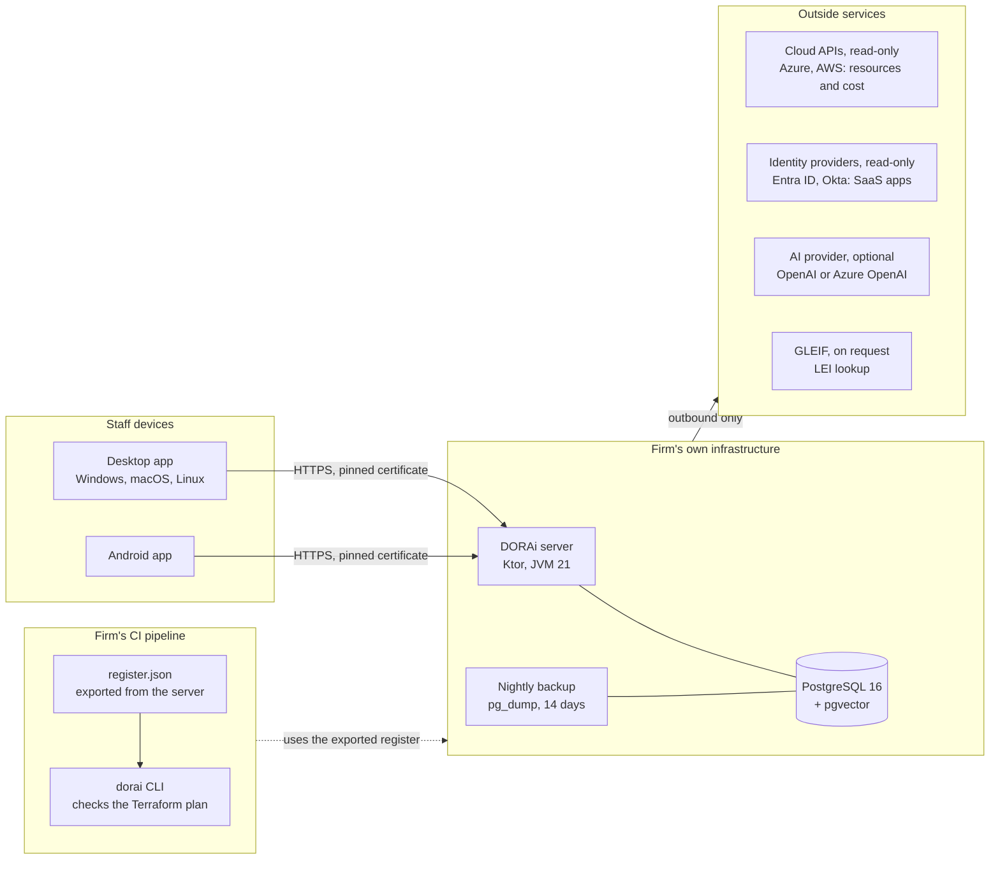

# DORAi

DORAi keeps a financial entity's DORA Register of Information in step with its real cloud.
The firm hosts the DORAi server itself. Staff connect from the desktop or Android app through an
invite link from their administrator.


What it does:
- Scans the cloud (Azure, AWS) and reads Terraform plans before they are applied.
- Compares what runs against the register with fixed rules and reports findings
  (new provider, data outside the EU/EEA, critical function affected, new service type, untagged resource).
- Uses AI to classify resources, suggest business functions and explain findings, always with a citation
  from the regulation. A person accepts or rejects every suggestion.
- Validates the register and exports it (EBA CSV) plus a PDF report.
- `dorai check plan.json --register register.json` runs the same rules in CI and fails the build on High findings; the GitHub Action posts them as a pull request comment ([docs/ci-check.md](docs/ci-check.md)).

## Architecture at a glance



One self-hosted Ktor server holds all data and is the only part that talks to the clouds and the AI provider. A
shared Kotlin Multiplatform module carries the JSON contract, the API client, the rules and the RoI builder, so the
server, the Compose apps (desktop and Android) and the CLI give identical answers. Rules decide findings; the AI only
drafts and explains, always with a citation, and a person accepts or rejects every value.

Read more: [architecture and why it fits the use case](docs/architecture.md) ·
[how the Register of Information is generated](docs/roi-generation.md) · [FAQ](docs/faq.md) ·
[decisions](docs/decisions.md)

## Modules

| Module | What | Runs on |
|---|---|---|
| `shared` | DTOs, API client, rules shared by server, apps and CLI | JVM, Android |
| `server` | Ktor API, Exposed + PostgreSQL (pgvector), collectors, AI (Koog), auth | JVM |
| `app` | Compose Multiplatform UI | Desktop, Android |
| `androidApp` | Android entry point (activity, manifest, deep links) | Android |
| `cli` | `dorai` command line | JVM |

## Prerequisites
- JDK 21
- Android SDK with platform 37 (`android-37.0`). Point Gradle to it with `ANDROID_HOME`
  or a `local.properties` file in the repo root (never committed): `sdk.dir=C\:/path/to/Android/Sdk`
  (forward slashes, the colon escaped).
- Docker, for PostgreSQL with pgvector once the database lands.

## Commands

```
./gradlew build                      # compile everything and run all tests
./gradlew :server:run                # API on http://localhost:8080 (DORAI_PORT to change)
./gradlew :app:run                   # desktop app
./gradlew :androidApp:installDebug   # Android app on a connected device or emulator
./gradlew :cli:run --args="--version"
```

On Windows use `gradlew.bat` or `.\gradlew`.

To run the whole app locally with no cloud keys, use `scripts/dev-local.sh` (Git Bash on Windows). It starts a
database in Docker, the server with the FinPay demo data and the fake AI, and the desktop app; log in as
`admin` / `dorai-local-dev`. `--server` skips the app, `--stop` stops the database, `--reset` deletes it.

Troubleshooting on Windows: if Gradle or the Android tools fail with "Unable to establish loopback
connection", set `JAVA_TOOL_OPTIONS=-Djdk.net.unixdomain.tmpdir=C:\tmp` (any short existing folder).

## Docs
- `CLAUDE.md`: how we work (read it, and so does your AI assistant)
- [`docs/architecture.md`](docs/architecture.md): architecture with diagrams, why it fits the use case, key decisions and trade-offs
- `docs/plan.md`: original plan, API and auth details
- `docs/decisions.md`: decisions as we make them
- [`CONTRIBUTING.md`](CONTRIBUTING.md): lanes, branches, pull requests, code and test rules
- [`SECURITY.md`](SECURITY.md): how to report a vulnerability, and the security model in short
- [`docs/roi-generation.md`](docs/roi-generation.md): how the Register of Information is generated, table by table:
  derived values and their trade-offs, what a person checks and writes, annex codes, rules, AI, security
- [`docs/faq.md`](docs/faq.md): frequently asked questions
