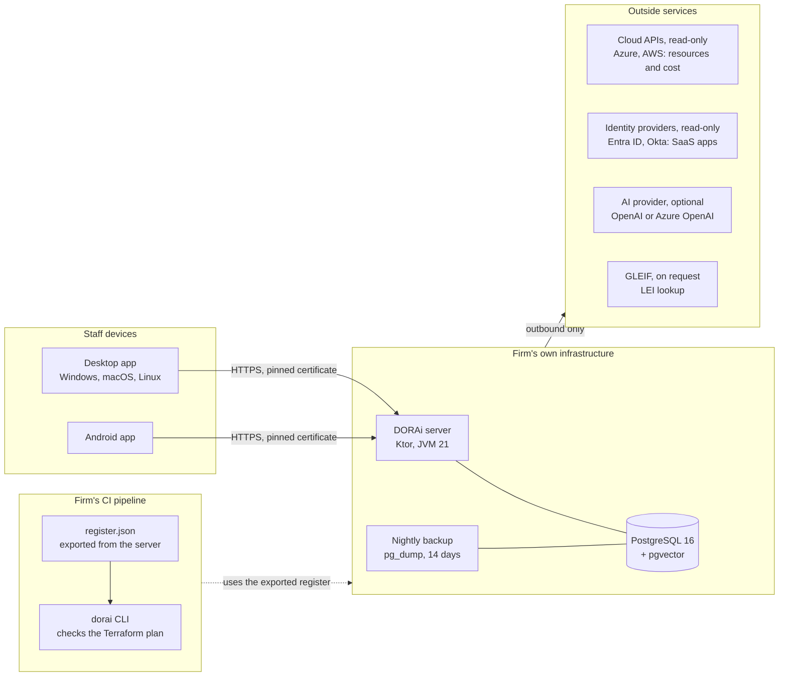
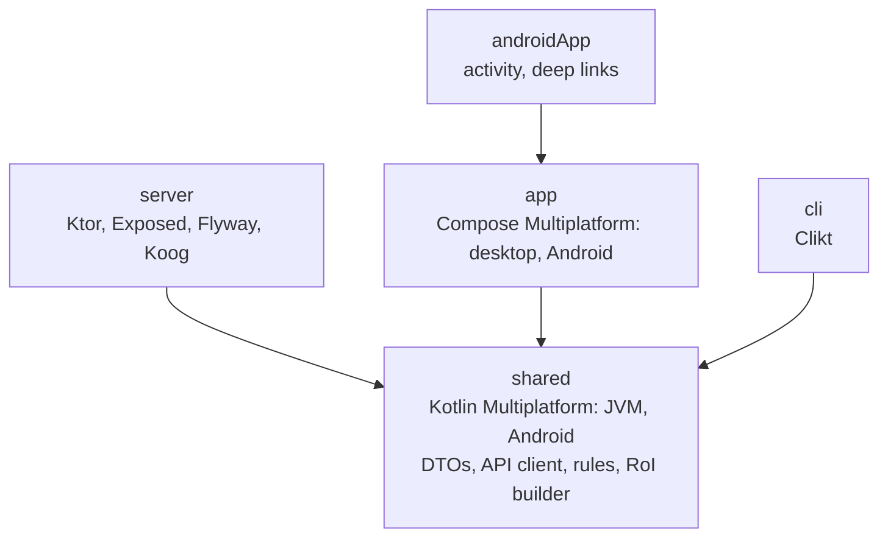
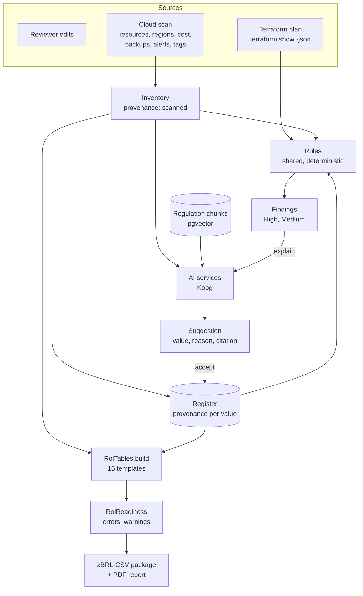
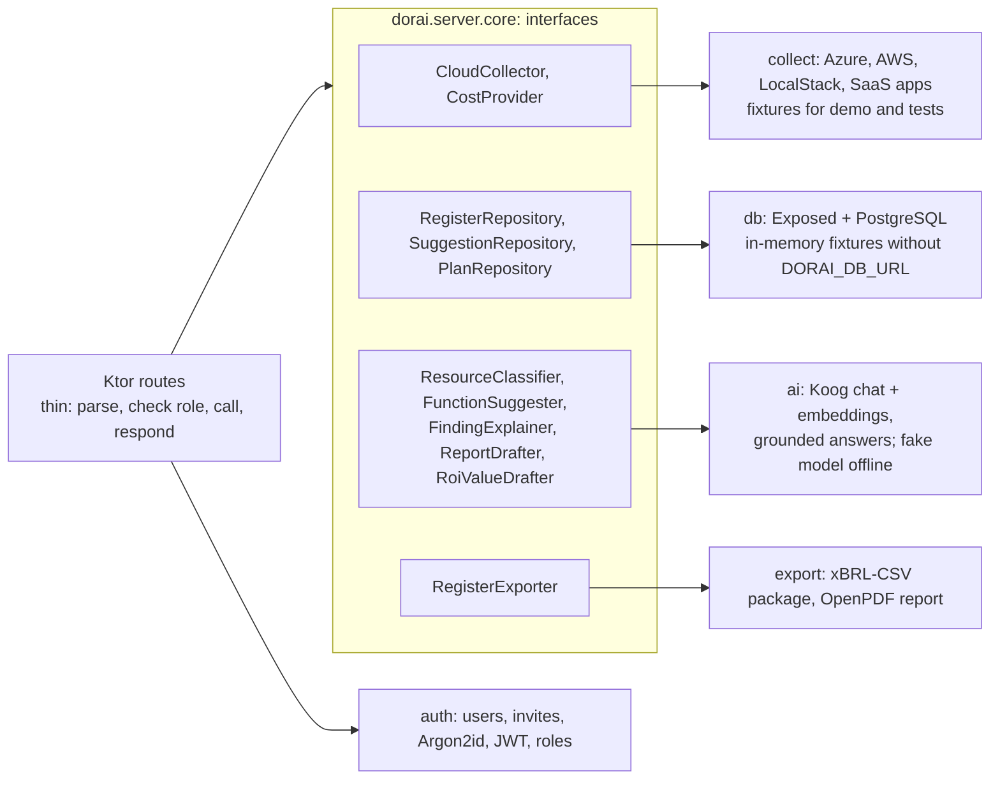
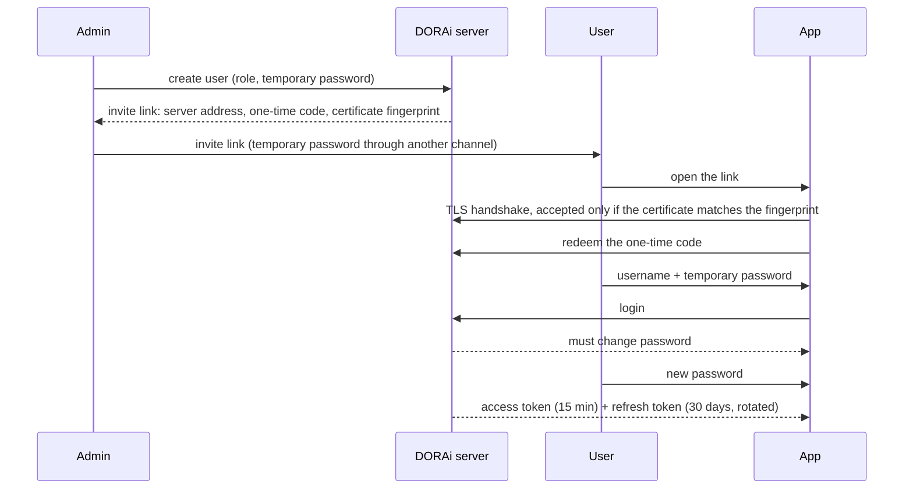

# DORAi architecture

As of 2026-11-22. DORAi is one self-hosted Kotlin server, a Kotlin Multiplatform module shared by every part, Compose
Multiplatform apps for desktop and Android, and a CLI for CI. This page explains the shape, why it fits the use case,
and the decisions behind it. Every decision has its own dated line in [decisions.md](decisions.md); how the Register of
Information itself is filled is in [roi-generation.md](roi-generation.md).

## The use case that shapes it

DORA makes a financial entity keep a Register of Information (RoI) of every ICT third-party arrangement, and keep it
true while its cloud changes every day. The architecture follows from six needs of that use case.

| Need | What it means for the architecture | Our answer |
| --- | --- | --- |
| The register, the cloud credentials and the findings are sensitive and supervised | The firm cannot hand them to a SaaS | A server the firm runs itself (Docker Compose), read-only cloud credentials, nothing calls home |
| A supervisor must be able to trace every finding | Findings cannot come from an AI model | Deterministic rules in plain Kotlin, pure functions with unit tests |
| The same rules must run before a change (Terraform plan in CI) and after it (live scan) | One implementation, two runtimes | Rules live in the `shared` Kotlin Multiplatform module, used by the server and the CLI |
| Compliance staff work on laptops; reviewers also on phones | Desktop and Android clients | One Compose Multiplatform UI codebase for both |
| AI helps with judgement, but an uncited or wrong answer must never reach the regulator | AI behind a strict boundary | Koog behind small interfaces, regulation search first, every answer cited or "insufficient evidence", a person accepts each value |
| The regulator's format changes (EBA taxonomy releases) | Format knowledge in one place | The RoI spec and the taxonomy code lists are data tables; a new release changes two files |

Two more constraints from the team: four people with one lane each, and a hackathon timeline. One language end to end,
one contract module and interfaces between lanes let everyone work in parallel without stepping on each other.

## System overview

- **Server**: the only component that holds data. It scans the cloud, keeps the register, runs rules and AI, builds the
  RoI and its exports. Settings and secrets come only from `DORAI_*` environment variables.
- **Apps**: show and edit the register, run scans, accept or reject AI suggestions, export. They never talk to a cloud
  or a model directly.
- **CLI**: runs in the firm's CI with the register as a JSON file and needs no network path to the server. It exits 1
  on a High finding, so a pull request that would break the register is blocked
  ([ci-check.md](ci-check.md)).
- **Outbound calls** are read-only (clouds, identity providers), on request (GLEIF), or chosen by the firm (the AI
  provider; the default is an offline fake model, so the server runs with no key at all).

## Modules

| Module | Runs on | Holds | Why it is separate |
| --- | --- | --- | --- |
| `shared` | JVM, Android | `dorai.shared.model` (the JSON contract), `dorai.shared.api` (Ktor client for every endpoint), `dorai.shared.rules` (plan reader, rules, validator), `dorai.shared.roi` (RoI spec, table builder, readiness checks) | Everything two runtimes must agree on is written once. A finding in the CLI, the server and the app is the same object from the same code |
| `server` | JVM | Routes, auth, database, collectors, AI, export | The only stateful part |
| `app` | Desktop, Android | Screens and ViewModels per feature (`shell`, `auth`, `inventory`, `review`, `findings`, `validation`, `register`, `roi`, `export`, `admin`) | One UI for both platforms; platform code only in `desktopMain` / `androidMain` |
| `androidApp` | Android | Activity, manifest, `dorai://connect` deep link | Android entry point |
| `cli` | JVM | `dorai check plan.json --register register.json` | Small, no server dependency, easy to run in any CI |

The RoI builder (`RoiTables`) and the readiness check live in `shared` for the same reason as the rules: the app can
show readiness per cell, and the server exports from exactly the same tables.

## How data flows

1. **Scan.** Collectors read the cloud (Azure, AWS, SaaS apps) into resources with their country, cost, backups, alerts
   and the `dora-function` / `dora-contract` tags. Scans run from the app or on a schedule (`DORAI_SCAN_EVERY`).
2. **Rules.** The same rules check a Terraform plan before apply (CLI) and the live inventory after it (server): new
   provider, data outside the EU/EEA, critical function at risk, untagged resource, new service type.
3. **AI suggests.** For values that need judgement (service type of an unknown resource type, business function, four
   RoI judgement columns) the AI searches the regulation, drafts one value with a citation, and stores it as a pending
   suggestion. A reviewer accepts (the value becomes `human-confirmed` with their name) or rejects it.
4. **Build at read time.** `RoiTables.build` turns the register plus the last scan into the 15 templates whenever they
   are read; scan-derived values are never stored, so the register follows the cloud with no sync job, and a person's
   value always wins.
5. **Check and export.** `RoiReadiness` applies the CIR's fill-in conditions, formats and cross references. The final
   EBA package is refused while errors remain; a `DRAFT_` package and the PDF are always available.

## Inside the server

- **Routes stay thin.** Logic sits behind interfaces in `dorai.server.core`; a route parses the request, the access
  plugin checks the role, and the route calls a service.
- **Wiring by hand.** One `Services` data class holds every implementation; no dependency-injection framework. Tests
  swap a single piece with `copy(...)`.
- **Two modes from one switch.** With `DORAI_DB_URL` set the server uses PostgreSQL, real auth and the real AI wiring;
  without it, it serves the FinPay demo data from memory with auth off. Tests and app work need no database.
- **Data model.** Exposed DSL tables, Flyway migrations (V1 to V6). Every register value stores its provenance
  (`scanned`, `planned`, `ai-suggested`, `human-confirmed`) with who and when; the 98 RoI columns beyond the named
  fields are a jsonb map per item, so one shape covers every template.
- **AI boundary.** AI services talk to a small `ChatModel` interface (Koog implementation, offline fake) and return
  `AiAnswer`: an answer with at least one citation, "insufficient evidence", or failed. The type enforces the product
  rule.
- **Errors** are RFC 9457 problem details; the API client in `shared` returns a sealed `ApiResult` and never throws,
  so every screen handles the error case.

## Connecting without a password

- The server makes its own self-signed certificate on first start. The app pins its SHA-256 fingerprint from the invite
  link, so no certificate authority is needed and a man-in-the-middle fails the handshake. Behind a Cloudflare Tunnel
  (`DORAI_PROXY=cloudflare`) the link carries no pin and the normal system trust applies instead.
- Invite codes are single use, valid 72 hours, stored as hashes. Passwords are Argon2id; repeated wrong passwords lock
  the username. Refresh tokens rotate, and reusing an old one ends the session.
- Roles: `admin` (users, invites, entity settings), `reviewer` (scan, accept or reject, edit, export), `viewer` (read
  only). The server checks the role on every route; new write routes are closed by default.
- Tokens at rest: Android Keystore on Android, the operating system keychain on desktop.

## Why Kotlin and the JetBrains stack

The use case needs the same logic in four places (server, desktop, Android, CI), a strict typed contract between them,
and an AI layer that is tested like the rest of the code. Kotlin is the one language that covers all of it.

| Part | Technology | Why it fits this use case |
| --- | --- | --- |
| Shared logic and contract | Kotlin Multiplatform | Rules, DTOs, the API client and the RoI builder compile for the JVM and Android from one source. A change to the contract breaks the build of every consumer, not a demo |
| Server | Ktor 3 | Light and embeddable: one process with TLS, rate limiting and JSON built in; coroutines for parallel cloud calls; a self-signed certificate with Ktor's certificate builder, so a firm installs with zero setup |
| API client | Ktor client | The same HTTP and serialization stack on both sides; the client in `shared` serves both apps and could serve the CLI |
| Desktop and Android UI | Compose Multiplatform | One UI codebase in `app/commonMain` for the two platforms firms asked for; platform code only where needed (file dialogs, keychain, deep links) |
| Navigation | Navigation Compose (JetBrains multiplatform port) | Type-safe routes and a ViewModel per screen on both platforms |
| AI | Koog | Kotlin-native LLM framework: structured output against a JSON schema (`executeStructured`), embeddings, a retrying client for rate limits. The AI is ordinary Kotlin code behind interfaces, tested with a fake model and no network |
| Database access | Exposed (DSL) | Typed SQL in Kotlin, no ORM magic, works with PostgreSQL types such as jsonb and pgvector |
| Serialization, time, async | kotlinx.serialization, kotlinx-datetime, coroutines | The same JSON and date types in common code on every platform |
| Build | Gradle Kotlin DSL, version catalog | One build for five modules and every platform |

Outside the JetBrains stack we use proven JVM libraries where they do one job well: PostgreSQL with pgvector, Flyway,
password4j (Argon2id), the Azure SDK and the AWS SDK for Kotlin, PDFBox (reading the regulation), OpenPDF (the report),
Apache Commons CSV, Clikt for the CLI.

## Key decisions and their trade-offs

| Decision | Why | Trade-off we accept |
| --- | --- | --- |
| Self-hosted server, no SaaS | Firms keep supervised data inside their perimeter | Each firm runs and backs up its own server (Docker Compose with a nightly backup makes that small) |
| Rules decide findings, AI only drafts and explains | A supervisor can trace every finding to code and a test | The AI cannot catch what no rule describes; new risks need a new rule |
| Rules and RoI builder in `shared` (KMP) | Server, app and CLI give identical answers | `shared` has to stay pure Kotlin, without JVM-only libraries |
| RoI built at read time, scan values not stored | No sync job; the register follows the cloud; a person's value is never overwritten | Each read recomputes the tables (cheap for one firm's register) |
| Every value carries provenance | An auditor sees what was scanned, suggested or confirmed, and by whom | More columns per field in the database |
| RoI columns as a jsonb map per item, values as text | One shape for 98 columns in 15 templates; one generic edit form | The readiness check parses values instead of the type system |
| CIR option keys stored, taxonomy codes only at export | The register stays readable against the regulation; a taxonomy release changes one generated table | A mapping step in the export |
| AI behind `ChatModel` and `AiAnswer`, regulation search first | No uncited answer can reach a reviewer; tests run offline; the provider can change | Extra plumbing compared with calling a model directly |
| Regulation search in PostgreSQL (pgvector) | One database for register and search, no extra service to run | Tied to PostgreSQL |
| Invite link with a pinned certificate | Self-signed certificates are safe, no password ever in a link | A changed certificate needs a new invite (the app says so) |
| Hand wiring, no DI framework | A dozen dependencies; tests swap one with `copy` | Wiring code grows with each service |
| CLI reads the register as a file | Any CI runner works, no network path to the firm's server | The file must be exported from the server to stay current |
| Fixture mode without a database | Tests and app work start instantly, no login | Two code paths for repositories |

## Deployment, CI and tests

- **Run**: `deploy/compose.yaml` starts `db` (PostgreSQL 16 with pgvector), `server` (image from GHCR, amd64 and arm64)
  and `backup` (nightly `pg_dump`, 14 days kept). HTTPS on 8443; plain HTTP only on the host for the health check.
  Details in [deploy.md](deploy.md).
- **Release**: a version tag builds the server image and setup bundle, desktop installers per platform (signed when
  the certificates are configured), the Android APK and the CLI.
- **CI**: every pull request runs `./gradlew build` (all tests), builds the server image, and can run the Arelle
  taxonomy validation of the demo RoI package.
- **Tests run offline**: fixtures for clouds, a fake AI model and embedder, Testcontainers with the same pgvector image
  as production for database tests, Turbine for ViewModel flows. No test touches a cloud or a real model.

## Read more

- [decisions.md](decisions.md): every decision with date, owner and reason
- [roi-generation.md](roi-generation.md): how each RoI table is filled and what a person checks and writes
- [plan.md](plan.md): original plan, API and auth details
- [deploy.md](deploy.md): installation and live scan settings
